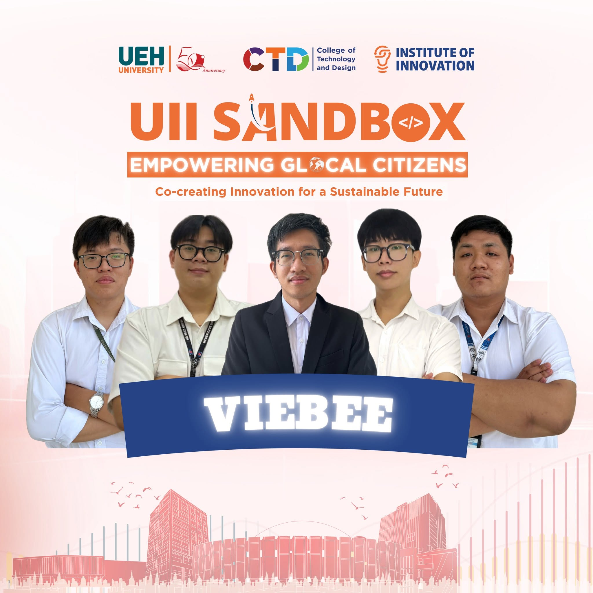

# VieBee - Mapping Living Heritage, Empowering Communities

<div align="center">


### Discover Vietnam Beyond the Guidebooks, Hosted by the Neighbors Who Live It.

**Preserving living heritage. Empowering local communities. Connecting cultures through technology.**

</div>

---

## Meet the Team
<div align="center">



**Five members. One shared vision.**

*Building a community-powered platform that connects travelers with authentic Vietnamese cultural experiences while helping local hosts preserve and share their heritage.*

</div>

---

## Multi-Repository Architecture

This workspace is structured into specialized, decoupled micro-repositories:

| Repository Directory | Technology Stack | Role & Responsibility | Port |
|---|---|---|---|
| **`viebee-application/`** | **Next.js 16 · React 19 · Tailwind v4 · AntD v6** | Web frontend: Living Heritage Map, Workshop Marketplace, Instant RSVP, Electronic QR Passes, Host Listing Wizard, QC Verification, and Offline LocalStorage fallback. | `3000` |
| **`viebee-backend/`** | **NestJS 11 · TypeScript · Clean Architecture · Prisma** | Main backend service: Workshop entity lifecycle, slot capacity control, 12% take rate calculation, electronic ticket generation, and AI proxying. | `4000` |
| **`viebee-ai-service/`** | **Python 3.11+ · FastAPI · Pydantic v2 · LangChain RAG** | Dedicated AI microservice: Bilateral language translation (EN ↔ VI), conversational tone polishing, and grounded Q&A over verified artisan knowledge sheets. | `8000` |
| **`viebee-knowledge-base/`** | **Markdown Engineering Docs** | 10 comprehensive architectural specifications, glossaries, conventions, flowcharts, and audit reports. | — |

---

## System Topology

```text
┌────────────────────────────────────────────────────────────────────────┐
│                        VieBee System Topology                          │
└────────────────────────────────────────────────────────────────────────┘

  [ Client: Next.js 16 Web App (:3000) ]
                  │
                  │ REST API + Bearer JWT
                  ▼
  [ Main Backend Service: NestJS 11 (:4000) ]
       ├── VB.VieBeeService.HttpApi
       │      REST Controllers, Guards, Interceptors
       ├── VB.VieBeeService.Application.Contracts
       │      Input/Output DTOs with Swagger
       ├── VB.VieBeeService.Application
       │      Use-Case Services, 12% Take Rate, Capacity
       ├── VB.VieBeeService.Domain
       │      Entities, Repository Interfaces
       ├── VB.VieBeeService.Domain.Shared
       │      Enums, Error Codes, BusinessException
       └── VB.VieBeeService.Infrastructure
              In-Memory Repositories, Prisma
                  │
                  │ HTTP REST Proxy
                  │ /copilot/chat, /copilot/translate
                  ▼
  [ AI Microservice: Python FastAPI (:8000) ]
       ├── LangChain + RAG Retrieval Pipeline
       ├── Verified Heritage Workshop Knowledge Sheets
       └── Bilateral Translation (English ↔ Vietnamese)
```

---

## Running the Services Locally

### 1. Web Application — Frontend

```bash
cd viebee-application
npm install
npm run dev
```

Accessible at [http://localhost:3000](http://localhost:3000).

### 2. Main Backend — NestJS

```bash
cd viebee-backend
npm install
npm run start:dev
```

- API: [http://localhost:4000/api](http://localhost:4000/api)
- Swagger documentation: [http://localhost:4000/api-docs](http://localhost:4000/api-docs)

### 3. AI Copilot Service — Python FastAPI

```bash
cd viebee-ai-service
pip install -r requirements.txt
python run.py
```

- API: [http://localhost:8000](http://localhost:8000)
- Swagger documentation: [http://localhost:8000/docs](http://localhost:8000/docs)

---

<div align="center">

**VieBee — Mapping Living Heritage, Empowering Communities**

*Technology with purpose. Culture with a future.*

</div>
